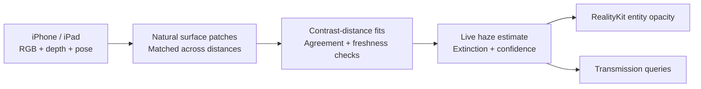

# MurkKit

**Smoke capture and volumetric interaction for native Apple apps.**

MurkKit is a Swift framework for bringing real smoke, fog, and haze into Apple-native spatial experiences. It combines iPhone or iPad camera and LiDAR observations into an estimated spatial model that developers can render, query, and share across devices.

Smoke becomes part of an app's understanding of its surroundings: virtual objects fade into real haze, virtual lights illuminate a representation of the medium, and interactive content responds to passing plumes. An iPhone provides the capture while Apple Vision Pro presents the experience through `MurkSync`.

## Add haze occlusion to a RealityKit app

Add this repository in Xcode's **Package Dependencies** and select the `MurkKit` product. Haze capture requires iOS/iPadOS 18 or later, a LiDAR-equipped device, and a camera usage description (`NSCameraUsageDescription`) in the host app.

Use an existing `ARView` in AR mode with automatic session configuration disabled. Enable scene depth on its world-tracking configuration before running it:

```swift
import ARKit
import MurkKit
import RealityKit

let configuration = ARWorldTrackingConfiguration()
guard ARWorldTrackingConfiguration.supportsFrameSemantics(.sceneDepth) else {
    return // Show your app's unsupported-device message.
}
configuration.frameSemantics.insert(.sceneDepth)
arView.automaticallyConfigureSession = false
arView.session.run(configuration)
```

Once the view is onscreen and tracking normally, call from the main actor:

```swift
let haze = MurkHaze.attach(to: arView)
try haze.startScanning()
haze.track(virtualObject)
```

Retain `haze` in your view controller or app model and use one controller per AR view. Start with the room already hazy: there is no physical target to place and no clear-air pass to capture. Starting can throw if scene depth or camera control is unavailable.

Walk slowly toward and away from textured, matte surfaces such as posters, patterned walls, or bookshelves. Keep the same details in view while changing their distance by at least about 0.6 m. MurkKit follows small surface patches in world coordinates and compares the contrast of the same physical details from different distances. Sideways movement alone or pointing at a blank wall may not provide enough evidence.

The result is one live estimate of approximately uniform haze in the observed area. At least three patches must agree before MurkKit fades tracked entities. It holds exposure and white balance steady while scanning, leaves focus under the host app's control, and rejects unsuitable observations. Keep lighting and the haze reasonably steady.

```swift
let estimate = haze.estimate
let transmission = estimate.transmittance(at: 2.0) // Optional transmission over 2 meters.
```

`estimate.confidence` is `.insufficient` while collecting useful views, `.low` when evidence is unsuitable or inconsistent, and `.usable` when enough patches agree. `extinctionCoefficient` is an optional estimate in inverse meters. Confidence describes internal agreement, not calibrated measurement accuracy. Transmission queries return `nil` unless usable and within the observed distance limit (`maximumDistance`).

Entities use their original opacity until the estimate is usable and return to it when observations become unreliable. Fading uses the camera-to-entity distance and the uniform-haze model. This is a room-level optical estimate; it does not locate individual smoke plumes in 3D.

```swift
haze.reset() // Start collecting fresh evidence after entering a new room or changing lighting.
```

```swift
haze.untrack(virtualObject) // Restore this entity's original opacity.
haze.detach()             // Restore all entities and release camera settings.
```

MurkKit leaves the session delegate and configuration under your app's control. While an entity is tracked, MurkKit owns its `OpacityComponent`; avoid changing it independently. Track either a parent or its children: overlapping registrations return `false` to avoid fading the same hierarchy twice.

Implementation notes and verification are recorded in [INCREMENTS.md](INCREMENTS.md).

## What developers can build

- AR compositing: add haze-aware occlusion to RealityKit apps so virtual objects fade according to the estimated smoke between the viewer and the object.
- Volumetric lighting in AR: render virtual lights, beams, and shadows through captured smoke using a renderer attachment with controls for lighting and appearance.
- Smoke-aware AR physics: query optical density and configurable drag or buoyancy responses at a point, allowing virtual objects to drift and react inside real plumes.
- Cross-device AR: capture smoke on an iPhone and stream its estimated volume to Vision Pro through `MurkSync`, keeping virtual content aligned with the same physical space.

Capture, rendering, interaction, and sharing are reusable capabilities

## How room scanning works



1. Find textured, approximately planar surfaces using camera imagery and reliable scene depth.
2. Anchor small patches to the scene and resample the same physical footprint as the camera moves.
3. Fit contrast loss against distance separately for each patch. Each patch has its own unknown intrinsic contrast, so the room can already be hazy when scanning starts.
4. Combine fresh, agreeing patches into one effective extinction coefficient. Insufficient travel, occlusion, poor geometry, inconsistent texture, and incompatible camera settings prevent a usable estimate.
5. Scale opted-in entities' original opacity with estimated transmission along their viewing paths.

Capture is bounded to a small set of patches and runs at approximately five updates per second. It requires no neural model, cloud service, or third-party dependency.

## Modules

MurkKit uses a modular Swift package structure, with a shared data model and optional capture, rendering, interaction, and networking components.

| Module | Responsibility |
| --- | --- |
| `MurkCore` | Volume and optical-path types, coordinate frames, timestamps, confidence, and transmittance queries |
| `MurkCapture` | iPhone/iPad capture adapters and tracked natural-surface observations |
| `MurkEstimate` | Contrast-distance attenuation estimation and observation quality checks |
| `MurkFusion` | Approximate spatial reconstruction and temporal updates of the medium |
| `MurkRender` | Metal volume rendering, haze-aware compositing, and adapters for Apple rendering frameworks |
| `MurkInteract` | Density sampling, configurable virtual drag/buoyancy responses, and simulation hooks |
| `MurkSync` | Cross-device field transport, coordinate alignment, and update timing |

A `MurkSession` coordinates the selected components. Pluggable sources let a renderer or interaction system consume live observations, recorded captures, or synthetic volumes through the same interface.

### Developer integration

Connect a capture or playback source to a session, attach a renderer to the app's scene, and query the resulting volume for optical density and transmittance between points. Apps retain control of their entities, appearance, and interaction rules.

Density samples represent estimated optical extinction. Drag and buoyancy responses come from a separately configured interaction model.

## Apple framework integration

| Platform | Role | Framework approach |
| --- | --- | --- |
| iOS / iPadOS | Capture, local rendering, and interactions on supported LiDAR-equipped devices | ARKit, Metal, and RealityKit; optional AVFoundation capture adapter |
| visionOS | Receive or replay captured fields and render spatial experiences | `MurkSync`, RealityKit, and a Metal/Compositor Services rendering path |
| Shared package components | Optical model, queries, recording format, and transport | Swift data types and Network framework integration |

For the primary capture adapter, ARKit supplies camera imagery and pose alongside `sceneDepth`, including its depth and confidence maps on supported devices. Apple's [scene-depth example](https://developer.apple.com/documentation/arkit/displaying-a-point-cloud-using-scene-depth) demonstrates these inputs. The alternative AVFoundation capture path provides [synchronized RGB and LiDAR depth](https://developer.apple.com/documentation/avfoundation/capturing-depth-using-the-lidar-camera), with different capabilities: it does not supply ARKit's world pose or confidence map automatically.

`MurkRender` handles platform-specific rendering through Metal and Apple rendering adapters. See Apple's [RealityKit Metal postprocessing example](https://developer.apple.com/documentation/realitykit/implementing-postprocess-effects-using-metal-compute-functions) and [Compositor Services mixed-immersion example](https://developer.apple.com/documentation/CompositorServices/interacting-with-virtual-content-blended-with-passthrough) for the underlying rendering APIs.

For cross-device AR, `MurkSync` carries the estimated field, confidence, timestamps, and spatial alignment information. Both devices establish a common coordinate frame to align the captured volume with the receiving device's view. Vision Pro uses iPhone-derived data, with rendering capabilities determined by the selected visionOS APIs.

## Capture model

For approximately uniform, steady haze, absolute texture contrast on a matte surface falls with camera-to-surface distance:

```text
C_p(d) = C_p(0) · exp(−σ · d)
ln C_p(d) = a_p − σ · d
T(d) = exp(−σ · d)
```

Each patch `p` has a different unknown intercept `a_p`. Comparing that same patch at several distances estimates the common extinction coefficient `σ` without observing it in clear air. `C_p` is the standard deviation of linear-light luminance over a matched physical patch, and `d` is Euclidean distance in meters. The near/far principle is described by [Du et al.](https://amt.copernicus.org/articles/6/2121/2013/); that work supports the measurement principle, rather than validating this indoor iPhone implementation.

Scene depth supplies surface geometry, not direct measurements of smoke particles. Fixed physical patch sampling, exposure checks, texture matching, and agreement checks reduce ambiguity, but changing illumination, camera tone mapping, reflections, defocus, and moving objects can still resemble haze. Rapidly changing or patchy smoke violates the room model. A single room coefficient is not a reconstructed density volume.

Optical extinction does not determine physical mass density, airflow, drag, or buoyancy. AR interactions and lighting effects use an optical estimate together with an app's rendering and simulation choices.

##Use
mit license
