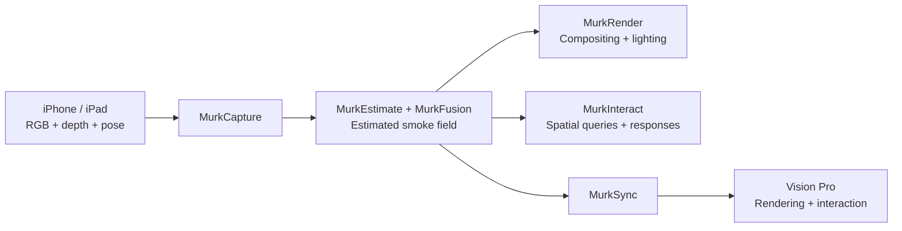

# MurkKit

**Smoke capture and volumetric interaction for native Apple apps.**

MurkKit is a Swift framework for bringing real smoke, fog, and haze into Apple-native spatial experiences. It combines iPhone or iPad camera and LiDAR observations into an estimated spatial model that developers can render, query, and share across devices.

Smoke becomes part of an app's understanding of its surroundings: virtual objects fade into real haze, virtual lights illuminate a representation of the medium, and interactive content responds to passing plumes. An iPhone provides the capture while Apple Vision Pro presents the experience through `MurkSync`.

## What developers can build

- AR compositing: add haze-aware occlusion to RealityKit apps so virtual objects fade according to the estimated smoke between the viewer and the object.
- Volumetric lighting in AR: render virtual lights, beams, and shadows through captured smoke using a renderer attachment with controls for lighting and appearance.
- Smoke-aware AR physics: query optical density and configurable drag or buoyancy responses at a point, allowing virtual objects to drift and react inside real plumes.
- Cross-device AR: capture smoke on an iPhone and stream its estimated volume to Vision Pro through `MurkSync`, keeping virtual content aligned with the same physical space.

Capture, rendering, interaction, and sharing are reusable capabilities

## How it works



1. Capture the scene. Acquire RGB, available depth/confidence, camera calibration, and poses from a supported device. A clear-air reference distinguishes the scene's appearance from the medium in front of it.
2. Estimate the medium. Infer optical attenuation from image changes and use reliable depth to locate background surfaces. Track confidence and observation age as smoke moves or capture conditions change.
3. Build a spatial representation. Fuse observations into an approximate field of optical density. Preserve which regions are observed, inferred, or unknown so apps can choose how to display them.
4. Render and interact. Integrate attenuation along viewing rays for compositing, raymarch the field for lighting effects, and expose spatial samples to the app's interaction model.
5. Share the experience. Send timestamped fields and their coordinate transforms to another device for rendering and interaction from its own viewpoint.

Live capture and recorded sessions feed the same pipeline, allowing developers to build and debug an effect against a repeatable recording.

## Modules

MurkKit uses a modular Swift package structure, with a shared data model and optional capture, rendering, interaction, and networking components.

| Module | Responsibility |
| --- | --- |
| `MurkCore` | Volume and optical-path types, coordinate frames, timestamps, confidence, and transmittance queries |
| `MurkCapture` | iPhone/iPad capture adapters, clear-air references, and session recording/replay |
| `MurkEstimate` | Image-based attenuation estimation and observation quality checks |
| `MurkFusion` | Approximate spatial reconstruction and temporal updates of the medium |
| `MurkRender` | Metal volume rendering, haze-aware compositing, and adapters for Apple rendering frameworks |
| `MurkInteract` | Density sampling, configurable virtual drag/buoyancy responses, and simulation hooks |
| `MurkSync` | Cross-device field transport, coordinate alignment, and update timing |

A `MurkSession` coordinates the selected components. Pluggable sources let a renderer or interaction system consume live observations, recorded captures, or synthetic volumes through the same interface.

### Developer integration

Connect a capture or playback source to a session, attach a renderer to the app's scene, and query the resulting volume for optical density and transmittance between points. Apps retain control of their entities, appearance, and interaction rules.

Density samples represent estimated optical extinction. Drag and buoyancy responses come from a separately configured interaction model.

## Apple framework integration

| Platform | Role | Framework approach |
| --- | --- | --- |
| iOS / iPadOS | Capture, local rendering, and interactions on supported LiDAR-equipped devices | ARKit, Metal, and RealityKit; optional AVFoundation capture adapter |
| visionOS | Receive or replay captured fields and render spatial experiences | `MurkSync`, RealityKit, and a Metal/Compositor Services rendering path |
| Shared package components | Optical model, queries, recording format, and transport | Swift data types and Network framework integration |

For the primary capture adapter, ARKit supplies camera imagery and pose alongside `sceneDepth`, including its depth and confidence maps on supported devices. Apple's [scene-depth example](https://developer.apple.com/documentation/arkit/displaying-a-point-cloud-using-scene-depth) demonstrates these inputs. The alternative AVFoundation capture path provides [synchronized RGB and LiDAR depth](https://developer.apple.com/documentation/avfoundation/capturing-depth-using-the-lidar-camera), with different capabilities: it does not supply ARKit's world pose or confidence map automatically.

`MurkRender` handles platform-specific rendering through Metal and Apple rendering adapters. See Apple's [RealityKit Metal postprocessing example](https://developer.apple.com/documentation/realitykit/implementing-postprocess-effects-using-metal-compute-functions) and [Compositor Services mixed-immersion example](https://developer.apple.com/documentation/CompositorServices/interacting-with-virtual-content-blended-with-passthrough) for the underlying rendering APIs.

For cross-device AR, `MurkSync` carries the estimated field, confidence, timestamps, and spatial alignment information. Both devices establish a common coordinate frame to align the captured volume with the receiving device's view. Vision Pro uses iPhone-derived data, with rendering capabilities determined by the selected visionOS APIs.

## Capture model

The estimator uses a simplified scattering model with a clear-air reference:

```text
I = J · T + A · (1 − T)
T = exp(−∫ σₑ(s) ds)
```

`I` is the observed image, `J` the clear-air appearance, `A` an airlight estimate, and `T` transmittance along the viewing ray. The extinction coefficient `σₑ` describes optical attenuation. RGB provides evidence about the medium's appearance; depth provides scene geometry where reliable.

A single view constrains attenuation along rays, so a 3D smoke field is inferred using multiple observations and modeling assumptions. Captured volumes expose confidence and unknown regions. The capture model assumes stable lighting, usable scene references, and light-to-moderate haze; rapidly changing or dense smoke may leave insufficient information.

Optical density alone does not measure mass density, airflow, drag, or buoyancy. `MurkInteract` uses configurable simulation parameters, and optionally a separately estimated flow field, to produce virtual responses. Lighting and disturbances are rendered effects; they do not physically illuminate or move real smoke. Compositing accounts for haze already present in the camera image to avoid applying it twice.

## License

[MIT](LICENSE).
